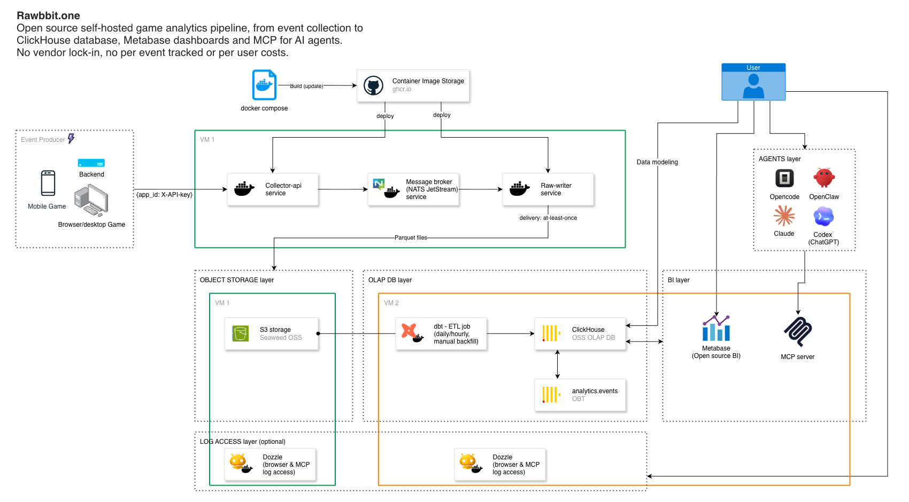

# Rawbbit

Rawbbit is a self-hosted event telemetry pipeline for mobile and web games.
It helps small teams collect player events, sessions, funnels, retention signals, economy events, monetization events, and backend game-service events while keeping ownership of the raw data.

It was created for teams that want game analytics without making a proprietary vendor the center of their telemetry stack.
The same pipeline also works for web apps, mobile apps, browser surfaces, and other event-producing products, but the OSS docs are written first for game developers operating their own stack.

Game clients, web builds, mobile apps, and backend services send batched events over HTTP.
Rawbbit validates and enriches those events in the collector, buffers them through [NATS JetStream](https://nats.io/), writes partitioned Parquet files to S3-compatible object storage such as [SeaweedFS](https://github.com/seaweedfs/seaweedfs), loads the raw layer into ClickHouse, and exposes the ClickHouse-backed data through MCP, Metabase, agents, and direct SQL access.



Main Rawbbit path:

```text
Producer -> Collector API -> NATS JetStream -> Raw Writer
  -> S3-compatible object storage / SeaweedFS Parquet
  -> scheduled dbt ingestion
  -> ClickHouse analytics.events
  -> MCP / Metabase / agents / users
```

Optional BigQuery path:

```text
Producer -> Collector API -> NATS JetStream -> Raw Writer
  -> object storage Parquet
  -> BigQuery external table
  -> SQLMesh base model
```

Storage note:
- SeaweedFS/S3-compatible storage is the preferred OSS raw-storage path
- GCS remains supported
- the BigQuery external-table path remains a supported optional downstream path, not the main architecture

Production-oriented OSS deployment is split into two provider-neutral VM
guides:

- VM one runs ingestion and raw object storage: Caddy, NATS JetStream,
  collector-api, raw-writer, and SeaweedFS, with optional Dozzle log access
- VM two runs analytics and access surfaces: ClickHouse, the scheduled Rawbbit
  dbt runner, the Rawbbit MCP server, Metabase, and Postgres for Metabase state,
  with optional Dozzle log access

The boundary between the VMs is the raw Parquet layer in S3-compatible object
storage.

## Table of contents

- [What is included](#what-is-included)
- [Architecture](#architecture)
- [Quickstart](#quickstart)
- [Published images](#published-images)
- [Configuration](#configuration)
- [Repository layout](#repository-layout)
- [Project status](#project-status)
- [Documentation](#documentation)
- [License](#license)

## What is included

This repository contains the public game-telemetry ingestion-to-analytics path:

- `backend/collector-api` — HTTP ingestion service for player, gameplay, product, and server events
- `backend/raw-writer` — JetStream consumer that writes partitioned Parquet files
- `clickhouse/` — main analytical/query path for loading and querying raw game telemetry in ClickHouse
- `dbt_project/` — scheduled dbt Core ingestion from bounded Parquet windows into `analytics.events`
- `mcp-server/` — Rawbbit MCP server, MCP client setup, and combined MCP + Metabase deployment guide
- AI agents and MCP clients such as Codex, OpenCode, and OpenClaw can connect to the Rawbbit MCP server endpoint for read-only analytics exploration
- `metabase/` — optional standalone Metabase deployment guide
- `sdk/rawbbit-unity/` — copy-in Unity C# SDK source, generic game-adapter template, and Editor/PlayMode test sources; Unity compilation and Android/iOS player/device validation are pending
- `sdk/rawbbit-browser-game/` — self-contained browser-game JavaScript SDK source with a durable queue, consent integration guide, tests, and a copy-in game-adapter template. The source builds without another SDK folder; the separate `@rawbbit/browser-game` npm package remains private and unpublished.
- `sqlmesh_project/` — optional [SQLMesh](https://sqlmesh.readthedocs.io/en/stable/) project for the BigQuery external-table path
- `plugins/rawbbit-game-events/` — coding-agent plugins for Claude and Codex that inspect a Unity or browser-JavaScript game, propose a reviewable event map, and integrate approved events with the bundled SDKs. See [`docs/agent-plugins.md`](docs/agent-plugins.md) for downloads and install steps.

## Architecture

The system is built around a few explicit boundaries:

- game clients, web builds, mobile apps, and backend services produce event batches
- the collector accepts and validates player and gameplay events
- [NATS JetStream](https://nats.io/) separates request handling from storage writes
- the raw writer lands durable Parquet files in object storage
- raw Parquet is the system-of-record boundary for downstream telemetry work
- scheduled dbt ingestion reconciles bounded Parquet windows into `analytics.events`; the shell loader remains a mutually exclusive legacy fallback
- ClickHouse is the main analytical database and serving path for retention, funnel, session, and event analysis
- MCP, Metabase, agents, and direct SQL are consumption surfaces on top of ClickHouse
- downstream modeling can evolve without changing the ingestion contract

For the deeper architecture note, see [`docs/architecture.md`](docs/architecture.md).

## Quickstart

For automated provider-neutral deployment of either VM or both, see
[`quickstart/ansible/README.md`](quickstart/ansible/README.md). The Ansible path
keeps SSH-key and `deploy` account creation manual, then configures the hosts,
installs Docker and authenticated Dozzle, renders Vault-backed private
configuration, starts Compose, and runs health checks.

For the recommended provider-neutral ingestion VM deployment guide, see
[`quickstart/vm_rawbbit_one/README.md`](quickstart/vm_rawbbit_one/README.md).
It deploys Caddy, NATS JetStream, collector-api, raw-writer, and SeaweedFS with
persistent host storage. It also documents optional Dozzle browser log access
and Dozzle MCP access for inspecting ingestion VM containers.

For the matching analytics VM deployment guide, see
[`quickstart/vm_rawbbit_two/README.md`](quickstart/vm_rawbbit_two/README.md).
It deploys ClickHouse, the persistent Rawbbit dbt runner, the Rawbbit MCP
server, Metabase, and Postgres for Metabase state. The dbt runner reads bounded
Parquet windows from the VM-one S3-compatible endpoint and loads them into
ClickHouse. It also documents optional Dozzle browser log access and Dozzle MCP
access for inspecting analytics VM containers.

The shortest path to a working ingestion setup is:

1. deploy VM one with the [Ansible quickstart](quickstart/ansible/README.md)
   (or the manual [VM-one guide](quickstart/vm_rawbbit_one/README.md))
2. send a test player event to `POST /v1/events:batch`
3. verify that Parquet files land in object storage

For the test event and landing check, see
[VM-one verification](quickstart/vm_rawbbit_one/README.md#verification).

## Published images

Rawbbit publishes public service images to GHCR:

- `ghcr.io/mirlan-irokez/rawbbit-collector-api:0.1.7`
- `ghcr.io/mirlan-irokez/rawbbit-raw-writer:0.1.8`
- `ghcr.io/mirlan-irokez/rawbbit-mcp-server:0.0.2`
- `ghcr.io/mirlan-irokez/rawbbit-dbt-runner:0.1.1`

The same images also have `latest` tags for convenience. Prefer pinned version tags for deployments.

The quickstart deployments pull these pinned images. To run local changes,
build an image from the service folder (for example
`docker build -t my-collector-api backend/collector-api`) and set that image in
`quickstart/vm_rawbbit_one/docker-compose.yml`.

Secrets are not baked into these images. Provide API keys, storage credentials, ClickHouse passwords, and MCP bearer tokens through private `.env` files or secret management.

## Configuration

The ingestion VM uses `quickstart/vm_rawbbit_one/.env.example` (the Ansible
path renders the same variables from
`quickstart/ansible/roles/rawbbit_one/templates/env.j2`); the ClickHouse/dbt
analytics VM uses `quickstart/vm_rawbbit_two/.env.example`.

Important configuration groups:

- NATS and stream settings
- collector API limits, API keys, CORS settings, and optional GeoIP-related attribution requirements
- raw-writer batching and ACK behavior
- object-storage bucket, prefix, and credentials
- dbt ingestion ownership, reconciliation windows, backfill chunking, and ClickHouse limits

For the grouped configuration guide, see [`docs/configuration.md`](docs/configuration.md).

## Repository layout

```text
backend/
  collector-api/   HTTP ingestion service
  raw-writer/      Parquet landing worker
sqlmesh_project/   Optional BigQuery SQLMesh starter model
clickhouse/        Main ClickHouse query/loading path
dbt_project/       Scheduled ClickHouse ingestion project
mcp-server/        Rawbbit MCP server and optional Metabase deploy path
metabase/          Metabase OSS ver. deploy instructions
sdk/rawbbit-unity/ Copy-in Unity SDK source, integration guide, and tests
sdk/rawbbit-browser-game/ Browser-game JavaScript SDK source and integration guide
plugins/rawbbit-game-events/
  claude/          Claude plugin (skills only) with bundled SDKs
  codex/           Codex plugin with bundled SDKs and optional SDK catalog
.claude-plugin/    Claude Code plugin marketplace for this repository
.agents/plugins/   Codex plugin marketplace for this repository
quickstart/        Provider-neutral VM deployment guides
docs/              OSS documentation
```

Component reference notes:

- [`backend/README.md`](backend/README.md)
- [`backend/collector-api/README.md`](backend/collector-api/README.md)
- [`backend/raw-writer/README.md`](backend/raw-writer/README.md)
- [`clickhouse/README.md`](clickhouse/README.md)
- [`dbt_project/README.md`](dbt_project/README.md)
- [`mcp-server/README.md`](mcp-server/README.md)
- [`metabase/README.md`](metabase/README.md)

## Project status

Current maturity:

- player event ingestion path is implemented
- raw Parquet landing path is implemented
- raw storage backend selection is implemented for both GCS and S3-compatible targets
- SeaweedFS/S3-compatible storage is the preferred OSS raw-storage path
- scheduled dbt loading from raw Parquet into ClickHouse is the main analytical/query path for player telemetry; the legacy shell loader remains available for rollback
- the current dbt project contains one ingestion model plus data tests; staging and mart models are intentionally deferred until their requirements are defined
- Rawbbit MCP server can expose a read-only analytical tool surface over a configured Rawbbit ClickHouse events table
- AI agents and MCP clients can use that MCP surface without direct access to the ingestion runtime
- Metabase can be deployed separately or together with the Rawbbit MCP server package
- BigQuery external-table querying is supported as an optional path
- [SQLMesh](https://sqlmesh.readthedocs.io/en/stable/) is included as an optional starter layer for the BigQuery path
- The copy-in Unity SDK is a source implementation; Unity Editor compilation, PlayMode tests, and Android/iOS player/device validation are not yet complete, so production compatibility is not established
- The browser-game SDK source is included and builds independently of other SDK folders; the separate npm package remains private and unpublished
- The browser-game SDK feature-checks secure top-level capabilities and has a passing Playwright run for Chromium, Firefox, and WebKit; no exact browser/version support matrix or real Safari/mobile-device validation is established.
- The Rawbbit Game Event Tracking plugins are downloadable from GitHub releases. The Claude plugin is submitted to Anthropic's plugin directory and the Codex plugin is not yet listed in OpenAI's directory; until then, install them from the release ZIPs as described in [`docs/agent-plugins.md`](docs/agent-plugins.md).

The current release is intentionally narrow: it focuses on reliable player-event ingestion, durable raw storage, ClickHouse-backed analytics, and agent/BI access on top of that serving layer.

The included [SQLMesh](https://sqlmesh.readthedocs.io/en/stable/) model is intentionally small. It reads from the BigQuery external table over the raw Parquet layer and serves as an optional BigQuery starter path rather than the central Rawbbit modeling layer.

## Documentation

- [`docs/architecture.md`](docs/architecture.md)
- [`quickstart/ansible/README.md`](quickstart/ansible/README.md)
- [`quickstart/vm_rawbbit_one/README.md`](quickstart/vm_rawbbit_one/README.md)
- [`quickstart/vm_rawbbit_two/README.md`](quickstart/vm_rawbbit_two/README.md)
- [`docs/configuration.md`](docs/configuration.md)
- [`clickhouse/README.md`](clickhouse/README.md)
- [`dbt_project/README.md`](dbt_project/README.md)
- [`mcp-server/README.md`](mcp-server/README.md) — includes Codex, OpenCode, and OpenClaw MCP client examples
- [`metabase/README.md`](metabase/README.md)
- [`sdk/rawbbit-unity/README.md`](sdk/rawbbit-unity/README.md) — Unity SDK installation, behavior, and validation status
- [`sdk/rawbbit-unity/INTEGRATION.md`](sdk/rawbbit-unity/INTEGRATION.md) — game-adapter and consent integration
- [`sdk/rawbbit-browser-game/README.md`](sdk/rawbbit-browser-game/README.md) — browser-game SDK installation and API overview
- [`sdk/rawbbit-browser-game/INTEGRATION.md`](sdk/rawbbit-browser-game/INTEGRATION.md) — host consent, storage, delivery, and recovery integration
- [`docs/browser-game-sdk.md`](docs/browser-game-sdk.md) — browser-game SDK local installation, integration, privacy, limits, and validation status
- [`docs/agent-plugins.md`](docs/agent-plugins.md) — download and install the Claude and Codex game-events plugins
- [`plugins/rawbbit-game-events/claude/README.md`](plugins/rawbbit-game-events/claude/README.md) — Claude plugin: what it runs and sends, privacy, and support
- [`plugins/rawbbit-game-events/codex/README.md`](plugins/rawbbit-game-events/codex/README.md) — Codex plugin: what it runs and sends to the SDK catalog, privacy, and support

## License

This project is released under the Apache License 2.0. See [`LICENSE`](LICENSE).

---

## Inspired by

- [awesome-data-engineering](https://github.com/igorbarinov/awesome-data-engineering) — for the broader data engineering ecosystem
