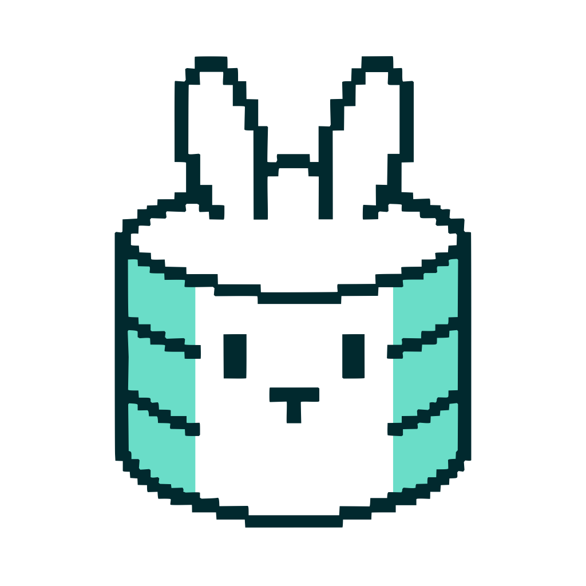

# Rawbbit.one Game Event Tracker for Claude

Design event maps, implement approved game analytics tracking, and maintain or migrate instrumentation in Unity and browser games.

This skills-only Claude plugin helps you design, integrate, migrate, and maintain game-specific event tracking for [Rawbbit](https://rawbbit.one/), a self-hosted game analytics pipeline. It works on Unity and browser-JavaScript games and includes the skill, integration guidance, Collector contract facts, and a pinned source inventory—not SDK code. After you approve the integration and SDK choice, the skill can fetch the selected complete SDK directory and root license from the [public Rawbbit repository](https://github.com/mirlan-irokez/rawbbit) at the exact commit recorded in the bundled source inventory, then verify the complete raw-byte inventory before copying.

## What it does

- Inspects your game's code and confirms its engine and target platform with you.
- Inventories existing Rawbbit and other-analytics events before proposing changes.
- Writes a reviewable event map (by default `docs/analytics/rawbbit-event-map.md`) with triggers, fields, consent, and identity decisions.
- After you approve specific events and the SDK choice, integrates them through a game-owned adapter using the verified pinned SDK, including dual-write alongside another analytics tool.
- Verifies the integration against a mocked Collector and reports which target-platform checks were not run.

## Install

Once the plugin is listed, add it from the Claude plugin directory. To try a local copy in Claude Code, run `claude --plugin-dir /path/to/rawbbit-game-events`.

In Claude Code or Cowork, the skill works on a local game checkout. In Claude chat without project files, it produces an event proposal or capability gap report only and says that no files were inspected or changed.

## What it runs and sends

- **The plugin itself sends nothing.** Enabling it makes no network requests and starts no services.
- **SDK download (only after your approval):** the skill downloads the selected SDK folder and the root `LICENSE` from the public GitHub repository at the pinned commit. The download is anonymous: it uses no credentials and sends no game data or ingest key. GitHub receives ordinary request metadata.
- **In your game project**, the skill may copy the verified SDK into the game, edit game code you approved, and run the game's own build and test commands. A browser SDK build may fetch the public npm dependencies listed in its lockfile after the verified SDK copy; Unity uses the game's Unity Editor and build tooling.
- **The integrated SDK** sends gameplay events only to the Rawbbit Collector URL that you configure in your game, and only after the game's consent gate allows it. The skill tests against a mocked Collector and does not send live traffic unless you explicitly authorize it.
- **Credentials:** the skill asks where your game stores its app-scoped ingest key, never for the key value, and commits only placeholders.

## Privacy

The full [Rawbbit Privacy Policy](https://rawbbit.one/privacy-policy) applies. In short:

- **No telemetry collection by the plugin.** The plugin collects, stores, and transmits no personal or usage data. Enabling the installed plugin makes no SDK-fetch or telemetry request. An approved SDK download contacts GitHub anonymously and sends no game data or ingest key.
- **Local project only.** The skill reads and edits files only in the game checkout you open. Event maps, code changes, and test output stay in that project.
- **Credentials.** The skill never asks for, stores, or commits an ingest key's value; it asks only where your game's configuration keeps it.
- **Your game's telemetry.** If you integrate an SDK, your game sends gameplay events to the Rawbbit Collector that you configure and operate, only after your game's consent gate allows it. Rawbbit does not host or receive that data. Your own privacy policy and player-consent flow govern it.

## Support

Get help, report bugs, and request features at [rawbbit.one/support](https://rawbbit.one/support), or email team@rawbbit.one.

See also the [Privacy Policy](https://rawbbit.one/privacy-policy) and [Terms of Service](https://rawbbit.one/terms-of-service).

## Contents

- [Skill workflow](skills/rawbbit-game-events/SKILL.md)
- [Pinned SDK source inventory](skills/rawbbit-game-events/references/sdk-source.json): public repository, commit, SDK versions, complete file hashes, root license hash, and Collector contract hash. The inventory detects mismatches but does not authenticate the publisher.
- [Collector contract facts](skills/rawbbit-game-events/references/collector-contract.json) and [field ownership guidance](skills/rawbbit-game-events/references/schema-and-field-ownership.md).
- [License](LICENSE): Apache-2.0. The selected SDK download includes the verified public repository root license and attribution.

## Limits

Unity Editor compilation, Android/iOS devices, Unity WebGL, and embedded or third-party-iframe browser contexts must be tested in your game; the plugin does not certify them. Other engines receive a capability gap report rather than a mismatched SDK.
