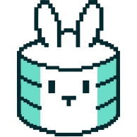

# Rawbbit Game Events for Claude

This skills-only Claude plugin helps you design, integrate, migrate, and maintain game-specific event tracking for [Rawbbit](https://rawbbit.one/), a self-hosted game analytics pipeline. It works on Unity and browser-JavaScript games and includes complete Unity and browser-game SDK source snapshots, integration guides, adapter templates, licenses, and Collector contract facts. It needs no MCP server, account, or access to another repository.

## What it does

- Inspects your game's code and confirms its engine and target platform with you.
- Inventories existing Rawbbit and other-analytics events before proposing changes.
- Writes a reviewable event map (by default `docs/analytics/rawbbit-event-map.md`) with triggers, fields, consent, and identity decisions.
- After you approve specific events, integrates them through a game-owned adapter using the bundled SDK, including dual-write alongside another analytics tool.
- Verifies the integration against a mocked Collector and reports which target-platform checks were not run.

## Install

Once the plugin is listed, add it from the Claude plugin directory. To try a local copy in Claude Code, run `claude --plugin-dir /path/to/rawbbit-game-events`.

In Claude Code or Cowork, the skill works on a local game checkout. In Claude chat without project files, it produces an event proposal or capability gap report only and says that no files were inspected or changed.

## What it runs and sends

- **The plugin itself sends nothing.** Installing it makes no network requests and starts no services.
- **In your game project**, the skill may copy one bundled SDK into the game, edit game code you approved, and run the game's own build and test commands. For the browser SDK that includes `npm ci`, `npm test`, and `npm run build` inside the copied SDK folder, which download public npm packages listed in its lockfile. For Unity it uses the game's Unity Editor and build tooling.
- **The integrated SDK** sends gameplay events only to the Rawbbit Collector URL that you configure in your game, and only after the game's consent gate allows it. The skill tests against a mocked Collector and does not send live traffic unless you explicitly authorize it.
- **Credentials:** the skill asks where your game stores its app-scoped ingest key, never for the key value, and commits only placeholders.

## Privacy

- **No data collection.** The plugin collects, stores, and transmits no personal or usage data. Rawbbit, the publisher, receives nothing from installing or using it.
- **Local project only.** The skill reads and edits files only in the game checkout you open. Event maps, code changes, and test output stay in that project.
- **Credentials.** The skill never asks for, stores, or commits an ingest key's value; it asks only where your game's configuration keeps it.
- **Your game's telemetry.** If you integrate the bundled SDK, your game sends gameplay events to the Rawbbit Collector that you configure and operate, only after your game's consent gate allows it. Rawbbit does not host or receive that data. Your own privacy policy and player-consent flow govern it.

## Contents

- [Skill workflow](skills/rawbbit-game-events/SKILL.md)
- [Unity SDK](skills/rawbbit-game-events/assets/sdk/rawbbit-unity/README.md) and [browser-game SDK](skills/rawbbit-game-events/assets/sdk/rawbbit-browser-game/README.md): copy the appropriate complete SDK into the game; do not build or install dependencies inside the plugin copy.
- [Bundle manifest](skills/rawbbit-game-events/assets/sdk/BUNDLE-MANIFEST.json): SDK versions and file hashes. Run `python3 scripts/verify_bundle.py` from the plugin folder to check them; hashes detect changes but do not authenticate a publisher.
- [Collector contract facts](skills/rawbbit-game-events/references/collector-contract.json) and [field ownership guidance](skills/rawbbit-game-events/references/schema-and-field-ownership.md).
- [License](LICENSE): Apache-2.0. Each copyable SDK snapshot includes its own license text.

## Limits

Unity Editor compilation, Android/iOS devices, Unity WebGL, and embedded or third-party-iframe browser contexts must be tested in your game; the plugin does not certify them. Other engines receive a capability gap report rather than a mismatched SDK.
